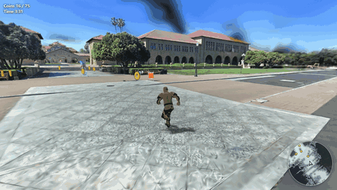
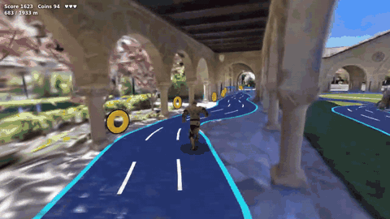
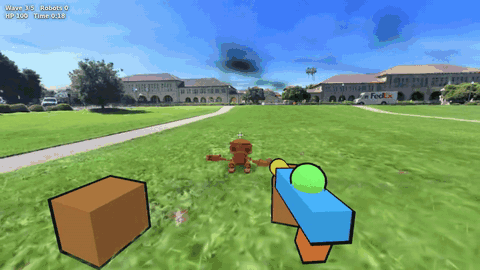
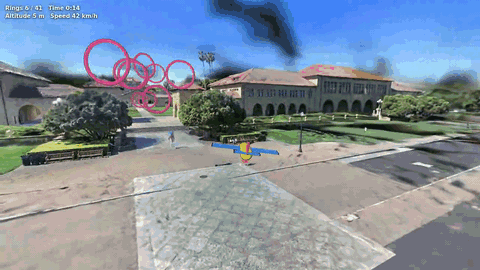

# lcc-playable

[](https://discord.gg/b99H8wjRaH)
[](https://developer.xgrids.com/#/forum)
[](https://xgrids.com/)

**A game development kit for XGRIDS LCC scenes, built for coding agents.**

Capture a real place with an XGRIDS scanner, then ask your coding agent (Claude Code, Codex, Cursor, ...) to turn the [LCC](https://www.xgrids.com/us/support/download/lcc-for-web) 3D Gaussian Splatting scene into a browser game:

> Make a game in the `temple` scene where the player delivers parcels to the landmarks before time runs out.

The agent reads [`AGENTS.md`](AGENTS.md), inspects the scene with the CLI, starts from one of the examples, plays the game headlessly with an autopilot to check it, and gives you a preview URL. `npm run build` turns the result into a static folder you can host anywhere.

[中文说明](README.zh-CN.md)

## Who it is for

Teams and developers who have LCC scenes, their own captures or XGRIDS samples, and want something people can play in them: interactive tours, mini-games, demos, prototypes. It is designed for working through a coding agent; the library also works by hand.

## What it is and is not

- **It is a starter kit.** You clone it and build games inside it. It contains a runtime library on top of the LCC Web SDK and three.js, a CLI that inspects scenes, checks games and builds them, four example games, and documentation written for agents.
- **It is not a replacement for the LCC Web SDK.** The SDK renders the scene; lcc-playable uses it and adds what a game needs.
- **It is not a general game engine or a multiplayer backend.** Games are static web pages with no server.

The library has two parts. The **core** (`lcc-playable`) covers what every game in a captured scene needs: ground, walkable area, collision, movement, cameras, the capture route, coverage and automated checks, and the build. The **kit** (`lcc-playable/kit`) holds optional gameplay helpers: characters, pickups, markers, roads, minimap, NPCs, contact shadows, toon style. Rules for a particular kind of game (weapons, lap times, scoring) live in the examples and in [`docs/game-types.md`](docs/game-types.md).

## Why lcc-playable

The LCC Web SDK shows a captured place. To play in it, a game also needs to know where the ground is, where a player can walk, how to keep the camera out of walls, and whether the result actually plays.

| | LCC Web SDK alone | with lcc-playable |
|-|-|-|
| Walkable ground, clearance, paths | build it from the collision mesh yourself | `p.geo.groundAt`, `walkable`, `findPath`, computed in a Worker or precomputed |
| Levels that pass every landmark | – | `p.geo.route()` follows the capture trajectory; `placeAlong`, `collectibles`, `beacon` |
| Characters at real scale | – | rigged human and robot, animated by `Walker`; `Navigator` for NPCs and autopilots |
| A camera that stays out of walls | – | `FollowCamera` (mouse look) and `FirstPersonCamera` |
| Smooth on laptops and phones | manual tuning | adaptive resolution and splat budget, phone preset, `?debug` overlay |
| Checking a game without a person | – | `npm run check -- games/<id> --auto`: headless GPU run, autopilot, screenshots, JSON report |
| Shipping | – | `npm run build`: one static folder, with third-party notices |

## Examples

All four examples, unchanged, in the **Stanford University sample scene from the [XGRIDS developer site](https://developer.xgrids.com/#/download?page=sampledata)** (60.7 M splats, collision mesh, 2.1 km capture trajectory). Animations: 5 s of autopilot play (`?auto`, as in `npm run check -- games/<id> --auto`), recorded in headless Chromium on an RTX 3060; every autopilot round was won, at 59–60 fps. The sample scene is for testing only and is not licensed for commercial use; the animations show it for documentation only.

| Explore & collect (`examples/explore`) | Runner (`examples/runner`) |
|-|-|
|  |  |
| 900 m of the capture route, 75 coins; won in 2:11 | road along the whole 1.9 km route; won in 4:17 |
| **First-person shooter (`examples/fps`)** | **Flight tour (`examples/flight`)** |
|  |  |
| 5 robot waves in the most open area; won in 0:33 | 41 rings along the route; won in 3:27 |

The dark blurs in the sky are floating splats in the capture, not rendering errors; `createPlayable({ sky: 'plain' })` replaces the captured sky with a gradient when they get in the way. More about each game type: [docs/game-types.md](docs/game-types.md).

## What you get

- **Core library** (`src/`, import from `lcc-playable`): `createPlayable()` loads an LCC scene and its walkable geometry and handles the title, pause, end and error cards. On top of that: ground queries and path finding, the capture route and coverage, collision rays and Rapier physics, controllers, cameras, keyboard/mouse/touch input, UI.
- **Kit** (`src/kit/`, import from `lcc-playable/kit`, optional): rigged human and robot characters, pickups and markers, roads, minimap, patrolling NPCs, contact shadows, toon materials.
- **Examples** (`examples/`): explore-and-collect, lane runner, first-person shooter with cartoon weapons, and a flight tour. Each is one `main.js` of 60–160 lines.
- **Docs for agents**: [`AGENTS.md`](AGENTS.md), [`docs/api.md`](docs/api.md), [`docs/game-types.md`](docs/game-types.md), [`docs/performance.md`](docs/performance.md), [`docs/scene-data.md`](docs/scene-data.md), [`docs/get-scenes.md`](docs/get-scenes.md), [`docs/lcc-sdk.md`](docs/lcc-sdk.md), [`llms.txt`](llms.txt), types in `src/index.d.ts` and `src/kit/index.d.ts`.
- **CLI**: inspect scenes (`npm run scene`), check a game in headless Chromium (`npm run check`), preview (`npm run dev`), build (`npm run build`).

## Quick start

Requires Node.js 20+ and a browser with WebGL 2 on a GPU.

1. **Install**: `git clone https://github.com/xgrids/lcc-playable.git && cd lcc-playable && npm install && npm run setup`. Setup downloads the LCC Web SDK from XGRIDS' official download server (sha256-checked) and headless Chromium (about 150 MB) for checks.
2. **Add a scene** you may use (see [Scene data](#scene-data)): `npm run scene -- add ~/Downloads/<scene>.zip --name myscene`.
3. **Ask your agent** in this folder, for example: *"Make an exploration game in myscene with five hidden objects near the landmarks."*
4. **Play**: `npm run dev`, then open http://localhost:8091/. The page lists every game and example. Add `?debug` to a game's URL for fps and position.

Without an agent:

```bash
npm run new -- my-game --from explore --scene myscene    # copies examples/explore to games/my-game
npm run dev                                              # http://localhost:8091/games/my-game/
npm run check -- games/my-game --auto                    # autopilot round, screenshots, JSON report
npm run build -- games/my-game                           # deployable folder in dist/my-game/
```

A complete small game (`npm run scene -- list` shows your scene's URL):

```js
import { createPlayable, Walker, FollowCamera } from 'lcc-playable';
import { loadCharacter, placeAlong, collectibles } from 'lcc-playable/kit';

const p = await createPlayable({ scene: '/scenes/myscene/scene.lcc2', title: 'Coin Walk' });
const route = p.geo.route();                                   // along the capture path, past every landmark
const coins = collectibles(p, placeAlong(p.geo, route, 12));   // a coin every 12 m, on walkable ground
const walker = new Walker(p, { character: await loadCharacter('human') });
const cam = new FollowCamera(p);                               // mouse to look, WASD to walk
p.onStart(() => { const s = route.sample(0); walker.teleport(s.x, s.y, s.yaw); cam.yaw = s.yaw; cam.reset(); });
p.onUpdate((dt) => {
  if (p.state === 'playing') walker.update(dt, { yaw: cam.yaw });
  cam.update(dt, walker.position, walker.heading);
  p.ui.hud(`Coins ${coins.got} / ${coins.total}`);
  if (p.state === 'playing' && coins.left === 0) p.win('All coins!');
});
p.run();
```

Status: 0.x. The API may still change between minor versions; see [CHANGELOG.md](CHANGELOG.md). Contributing: [CONTRIBUTING.md](CONTRIBUTING.md). Security: [SECURITY.md](SECURITY.md).

## Scene data

lcc-playable reads `.lcc2` scenes, with or without a collision mesh (`.ply`). Scenes captured without LiDAR, or exported without the mesh, get ground, walkable area and collision estimated from the splats; game code does not change (accuracy and limits: [docs/api.md](docs/api.md#scenes-without-a-collision-mesh)). The capture trajectory (`info/poses.json`) is optional: where present, the parts the scanner was carried over the ground help pick the ground and the default route; rides on chairlifts or vehicles are ignored. It does not download scene data for you.

- [docs/get-scenes.md](docs/get-scenes.md): download a sample scene (account needed) or export your own, and give it to your agent.
- [docs/scene-data.md](docs/scene-data.md): what a playable scene needs (Z up, meters, collision mesh, trajectory); `npm run scene -- info` checks it.

**XGRIDS sample data is for testing only.** Use scenes of your own, or the sample scenes on the [XGRIDS developer site](https://developer.xgrids.com/#/download?page=sampledata). Downloading samples requires a login. The samples may be used for testing, learning and evaluation and are not licensed for commercial use. For anything you ship, use scenes you captured yourself or have the rights to.

## Third-party components

| Component | Source | License | In this repo |
|-|-|-|-|
| LCC Web SDK 0.6.4 (closed source) | [xgrids.com](https://www.xgrids.com/us/support/download/lcc-for-web), via `npm run setup`; version and upgrades: [docs/lcc-sdk.md](docs/lcc-sdk.md) | XGRIDS terms; may be redistributed inside your game | No |
| LCC2 data organization format | [LCC2 White Paper](https://github.com/xgrids/LCC2Whitepaper); lcc-playable reads `.lcc2`, `.sog` and PLY files itself | LCC2 White Paper license (attribution, see below) | Reader code only |
| Sample scene data | XGRIDS developer site (login required) | Testing only, no commercial use | No |
| three.js | npm | MIT | No (npm) |
| Rapier (`@dimforge/rapier3d-compat`) | npm | Apache-2.0 | No (npm) |
| Characters `human.glb`, `robot.glb` | Quaternius, three.js examples | CC0 1.0 | Yes |

`npm run build` puts the LCC Web SDK, three.js, Rapier and the characters into the build and writes their licenses to `THIRD_PARTY_NOTICES.txt` next to the game. You may publish the build with the SDK in it. Without an XGRIDS appKey the SDK draws a small XGRIDS watermark in the bottom-right corner on deployed sites (not on localhost); everything else works the same.

The LCC2 White Paper license asks every product that uses the format to show "Data Organization Format originated from XGRIDS". Games show this line, linked to the white paper, on the loading screen and on every card; keep it. The build's `THIRD_PARTY_NOTICES.txt` carries the rest of the required notices (XGRIDS owns the format; it may not be used to train AI models that compete with XGRIDS). If you modify `.lcc2` files and pass them on, state that they were modified.

## License

The code and docs in this repository are licensed under [Apache-2.0](LICENSE). The license does not cover XGRIDS trademarks, the LCC Web SDK, or scene data. See [NOTICE](NOTICE).
