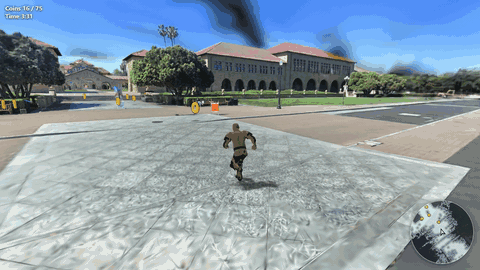
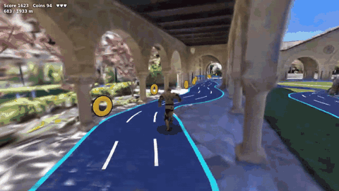
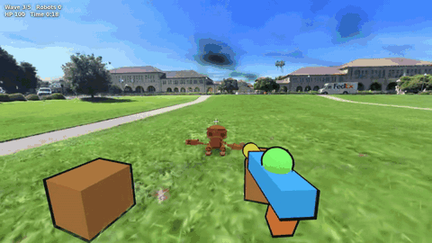
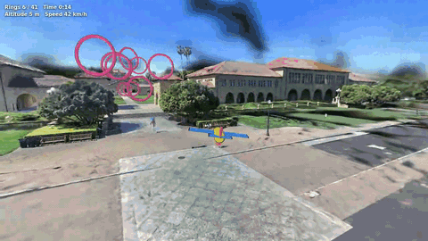

# lcc-playable

[](https://discord.gg/b99H8wjRaH)
[](https://developer.xgrids.com/#/forum)
[](https://xgrids.com/)

**面向 coding agent 的 XGRIDS LCC 场景游戏开发套件。**

用 XGRIDS 扫描设备采集一个真实地点，然后让你的 coding agent（Claude Code、Codex、Cursor 等）把这个 [LCC](https://www.xgrids.com/us/support/download/lcc-for-web) 3DGS 场景做成浏览器游戏：

> 用 temple 场景做一个限时送外卖的游戏，把包裹送到几个地标。

agent 会读 [`AGENTS.md`](AGENTS.md)，用命令行了解场景，从示例开始改，用自动驾驶在无头浏览器里把游戏玩一遍来检查，最后给你预览地址。`npm run build` 把结果打包成一个静态目录，放到任何静态托管上都能玩。

[English](README.md)

## 适合谁

手里有 LCC 场景（自己采集的或 XGRIDS 样例），想在场景里做出可玩内容的团队和开发者，比如互动导览、小游戏、演示和原型。它按「通过 coding agent 开发」来设计，不用 agent 也可以直接调用库。

## 它是什么，不是什么

- **它是一个开发套件。** clone 下来，在里面做游戏。包含：基于 LCC Web SDK 和 three.js 的运行时库；用来了解场景、检查游戏、打包发布的命令行；四个示例游戏；写给 agent 的文档。
- **它不替代 LCC Web SDK。** SDK 负责渲染场景，lcc-playable 调用 SDK，补上做游戏需要的部分。
- **它不是通用游戏引擎，也没有多人联机后端。** 游戏是纯静态网页，不需要服务器。

库分两部分。**核心库**（`lcc-playable`）只负责采集场景里每个游戏都需要的部分：地面、可走区域、碰撞、移动、相机、采集路线、覆盖率和自动检查、打包。**玩法组件**（`lcc-playable/kit`）是可选的：角色、拾取物、标记、路面、小地图、NPC、卡通材质。具体玩法的规则（武器、圈速、计分等）放在示例和 [`docs/game-types.md`](docs/game-types.md) 里。

## 为什么用 lcc-playable

LCC Web SDK 负责把采集的场景显示出来。要在里面玩，游戏还需要知道地面在哪、哪里能走、相机怎么不穿墙、做出来能不能玩通。

| | 只用 LCC Web SDK | 加上 lcc-playable |
|-|-|-|
| 可走地面、通行宽度、寻路 | 自己从碰撞网格算 | `p.geo.groundAt`、`walkable`、`findPath`，在 Worker 里现算或提前预处理 |
| 经过每个地标的关卡 | – | `p.geo.route()` 沿采集轨迹；`placeAlong`、`collectibles`、`beacon` |
| 真实比例的角色 | – | 带骨骼动画的真人和机器人，`Walker` 自动播放动作；`Navigator` 用于 NPC 和自动驾驶 |
| 不穿墙的相机 | – | `FollowCamera`（鼠标转视角）和 `FirstPersonCamera` |
| 笔记本和手机上流畅 | 手动调 | 自动调节分辨率和高斯数量、手机预设、`?debug` 调试面板 |
| 不用人工也能验证游戏 | – | `npm run check -- games/<id> --auto`：无头 GPU 运行、自动驾驶、截图、JSON 报告 |
| 发布 | – | `npm run build`：一个静态目录，附第三方许可说明 |

## 示例

下面四个示例都没有改代码，直接运行在 **[XGRIDS 开发者网站](https://developer.xgrids.com/#/download?page=sampledata)的 Stanford University 样例场景**上（6070 万个高斯，带碰撞网格和 2.1 km 采集轨迹）。动图是自动驾驶（`?auto`，和 `npm run check -- games/<id> --auto` 相同）玩的 5 秒，在无头 Chromium、RTX 3060 上录制，自动驾驶每一局都通关，帧率 59~60 fps。样例场景仅供测试，不授权商用；这里的动图只用于说明文档。

| 探索收集（`examples/explore`） | 跑酷（`examples/runner`） |
|-|-|
|  |  |
| 采集路线前 900 m，75 枚金币；2:11 通关 | 沿整条 1.9 km 路线铺路；4:17 通关 |
| **第一人称射击（`examples/fps`）** | **飞行漫游（`examples/flight`）** |
|  |  |
| 在最开阔的区域打 5 波机器人；0:33 通关 | 沿路线 41 个圈；3:27 通关 |

天空中的深色模糊团块是采集数据里的漂浮高斯，不是渲染错误；影响画面时可以用 `createPlayable({ sky: 'plain' })` 换成渐变天空。各类玩法的说明见 [docs/game-types.md](docs/game-types.md)。

## 包含什么

- **核心库**（`src/`，`import ... from 'lcc-playable'`）：`createPlayable()` 加载 LCC 场景和可走区域，自带开始、暂停、结束和报错卡片。此外有地面查询和寻路、采集路线和覆盖率、碰撞射线和 Rapier 物理、控制器、相机、键盘/鼠标/触控输入、界面。
- **玩法组件**（`src/kit/`，`import ... from 'lcc-playable/kit'`，可选）：带骨骼动画的真人和机器人角色、拾取物和标记、路面、小地图、巡逻 NPC、脚下阴影、卡通材质。
- **示例**（`examples/`）：探索收集、跑酷、卡通武器的第一人称射击、飞行漫游。每个示例只有一个 60~160 行的 `main.js`。
- **给 agent 的文档**：[`AGENTS.md`](AGENTS.md)、[`docs/api.md`](docs/api.md)、[`docs/game-types.md`](docs/game-types.md)、[`docs/performance.md`](docs/performance.md)、[`docs/scene-data.md`](docs/scene-data.md)、[`docs/get-scenes.md`](docs/get-scenes.md)、[`docs/lcc-sdk.md`](docs/lcc-sdk.md)、[`llms.txt`](llms.txt)，类型声明在 `src/index.d.ts` 和 `src/kit/index.d.ts`。文档是英文。
- **命令行**：了解场景（`npm run scene`）、在无头 Chromium 里检查游戏（`npm run check`）、预览（`npm run dev`）、打包（`npm run build`）。

## 快速开始

需要 Node.js 20 以上，以及能用显卡跑 WebGL 2 的浏览器。

1. **安装**：`git clone https://github.com/xgrids/lcc-playable.git && cd lcc-playable && npm install && npm run setup`。setup 会从 XGRIDS 官方下载服务器下载 LCC Web SDK（校验 sha256），并安装用于检查的无头 Chromium（约 150 MB）。
2. **导入场景**（你有权使用的，见[场景数据](#场景数据)）：`npm run scene -- add ~/Downloads/<场景>.zip --name myscene`。
3. **让 agent 做游戏**，在这个目录里说，例如：*「用 myscene 做一个探索游戏，在地标附近藏 5 个物品。」*
4. **试玩**：`npm run dev`，打开 http://localhost:8091/ ，首页列出所有游戏和示例。游戏网址后加 `?debug` 可以看帧率和位置。

不用 agent 时：

```bash
npm run new -- my-game --from explore --scene myscene    # 把 examples/explore 复制到 games/my-game
npm run dev                                              # http://localhost:8091/games/my-game/
npm run check -- games/my-game --auto                    # 自动驾驶跑一局，截图，输出 JSON 报告
npm run build -- games/my-game                           # 可部署的目录 dist/my-game/
```

完整代码示例见[英文 README](README.md#quick-start)。

当前是 0.x 版本，小版本之间 API 可能变化，见 [CHANGELOG.md](CHANGELOG.md)。参与贡献见 [CONTRIBUTING.md](CONTRIBUTING.md)，安全问题见 [SECURITY.md](SECURITY.md)。

## 场景数据

支持 `.lcc2` 场景，有没有碰撞网格（`.ply`）都可以。没有激光雷达采集、或导出时没带碰撞网格的场景，地面、可走区域和碰撞会从高斯估算，游戏代码不用改（精度和限制见 [docs/api.md](docs/api.md#scenes-without-a-collision-mesh)）。采集轨迹（`info/poses.json`）可选：有轨迹时，用其中贴地行走的部分帮助确定地面和默认路线，坐缆车、坐车等离地的部分会被忽略。本仓库不会替你下载场景数据。

- [docs/get-scenes.md](docs/get-scenes.md)：下载官网样例场景（需要注册登录）或导出自己的场景，以及怎么交给 agent。
- [docs/scene-data.md](docs/scene-data.md)：可玩场景需要什么（Z 轴朝上、米为单位、碰撞网格、采集轨迹）；`npm run scene -- info` 会逐项检查。

**XGRIDS 样例数据仅供测试。** 可以用你自己的场景，或者 [XGRIDS 开发者网站](https://developer.xgrids.com/#/download?page=sampledata) 上的样例场景（下载需要登录）。样例场景只能用于测试、学习和评估，不授权商业使用。要发布或商用的游戏，请使用你自己采集或已获得授权的场景。

## 第三方组件

| 组件 | 来源 | 授权 | 是否在仓库里 |
|-|-|-|-|
| LCC Web SDK 0.6.4（闭源） | [xgrids.com](https://www.xgrids.com/us/support/download/lcc-for-web)，`npm run setup` 下载；版本和升级见 [docs/lcc-sdk.md](docs/lcc-sdk.md) | XGRIDS 条款；可以随游戏一起分发 | 否 |
| LCC2 数据组织格式 | [LCC2 白皮书](https://github.com/xgrids/LCC2Whitepaper)；lcc-playable 自己读取 `.lcc2`、`.sog` 和 PLY 文件 | LCC2 白皮书许可（需标注来源，见下） | 只有读取代码 |
| 样例场景数据 | XGRIDS 开发者网站（需登录） | 仅限测试，不能商用 | 否 |
| three.js | npm | MIT | 否（npm 安装） |
| Rapier（`@dimforge/rapier3d-compat`） | npm | Apache-2.0 | 否（npm 安装） |
| 角色 `human.glb`、`robot.glb` | Quaternius、three.js 示例 | CC0 1.0 | 是 |

`npm run build` 会把 LCC Web SDK、three.js、Rapier 和角色打进包里，并在游戏目录下写一份 `THIRD_PARTY_NOTICES.txt` 列出它们的许可证。打包产物可以连同 SDK 一起发布。没有 XGRIDS appKey 时，部署到线上的页面右下角会有一个小的 XGRIDS 水印（localhost 上没有），其他功能不受影响。

LCC2 白皮书的许可要求，使用该格式的产品要显示「Data Organization Format originated from XGRIDS」。游戏会在加载画面上显示这行字，并链接到白皮书，请保留。打包产物里的 `THIRD_PARTY_NOTICES.txt` 写有白皮书要求的其他声明（格式归 XGRIDS 所有；不得用于训练与 XGRIDS 竞争的 AI 模型）。如果修改了 `.lcc2` 文件并提供给他人，要注明已修改。

## 许可证

本仓库的代码和文档使用 [Apache-2.0](LICENSE)。许可证不包括 XGRIDS 商标、LCC Web SDK 和场景数据，见 [NOTICE](NOTICE)。
